# ☕ Clash Coffee Shop Application

Aplikasi pemesanan kopi dan makanan secara *online* berbasis mobile untuk **Clash Coffee Shop**. Aplikasi ini dirancang untuk memberikan pengalaman pemesanan yang cepat, praktis, dan intuitif bagi pengguna.

---

## Fitur Utama

- **Otentikasi Pengguna**: Layar Welcome, Login, dan Register untuk pengguna baru maupun member lama.
- **Katalog Menu & Promo**: Menampilkan daftar makanan dan minuman lengkap dengan harga, deskripsi, serta banner penawaran spesial (*Clash Deal*).
- **Manajemen Keranjang (Cart)**: Menambah, mengedit jumlah item, hingga menghitung total pembayaran secara langsung.
- **Pengiriman & Alamat**: Penginputan nama penerima, alamat detail, dan rincian pesanan.
- **Metode Pembayaran**:
  - *Transfer Bank* (Dilengkapi nomor rekening tujuan)
  - *QRIS* (Scan via e-wallet / mobile banking)
  - *Cash on Delivery / COD* (Bayar tunai di tempat)
- **Status & Konfirmasi Pesanan**: Layar konfirmasi transaksional dan riwayat pesanan (*Order History*).
- **Profil Pengguna**: Pengaturan data akun dan profil pelanggan.

---

## Teknologi & Penyimpanan Data

- **Frontend**: Flutter / Android Native (Java/Kotlin)
- **Pengolahan Data (Database)**: *Local Storage / In-Memory State* (Data tersimpan langsung di dalam perangkat/HP pengakses tanpa database server eksternal).
- **IDE**: Android Studio
- **Version Control**: Git & GitHub

---

## Cara Menjalankan Aplikasi

1. **Clone Repository**
   ```bash
   git clone [https://github.com/Fadhillahrizqia/Clash_Coffee_Shop.git](https://github.com/Fadhillahrizqia/Clash_Coffee_Shop.git)


## Dokumentasi
## 📱 Tangkapan Layar (Screenshots)

| Halaman | Tampilan |
| :--- | :---: |
| **01. Welcome** | 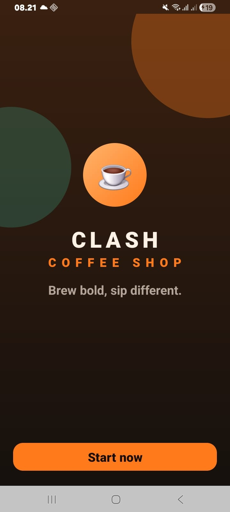 |
| **02. Sign Up** | 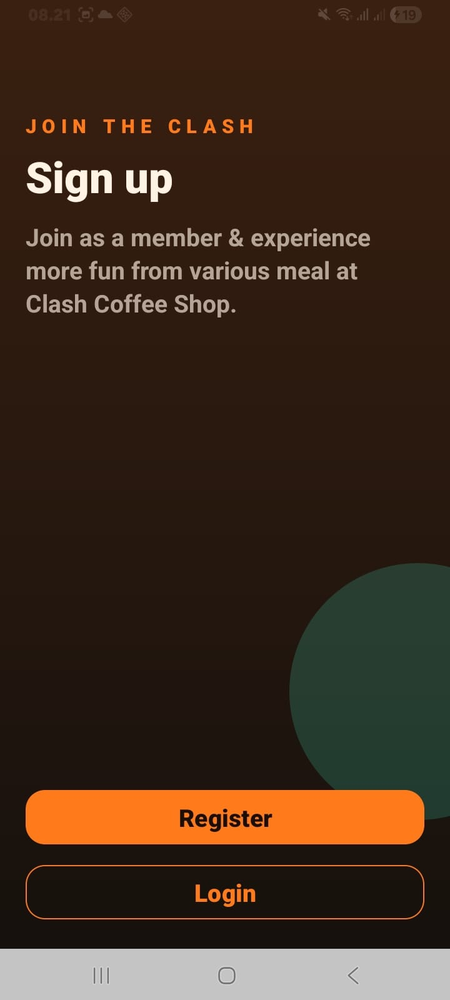 |
| **03. Login** | 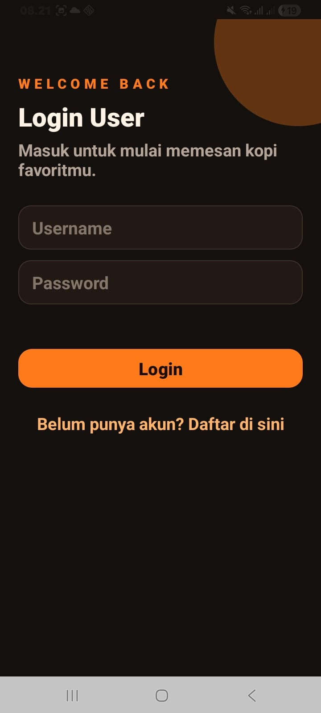 |
| **04. Register** | 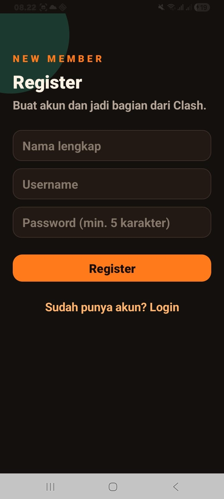 |
| **05. Home & Menu** | 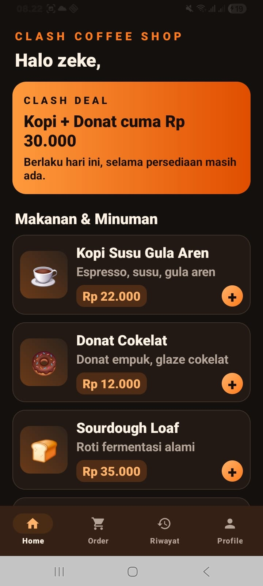 |
| **06. Keranjang** | 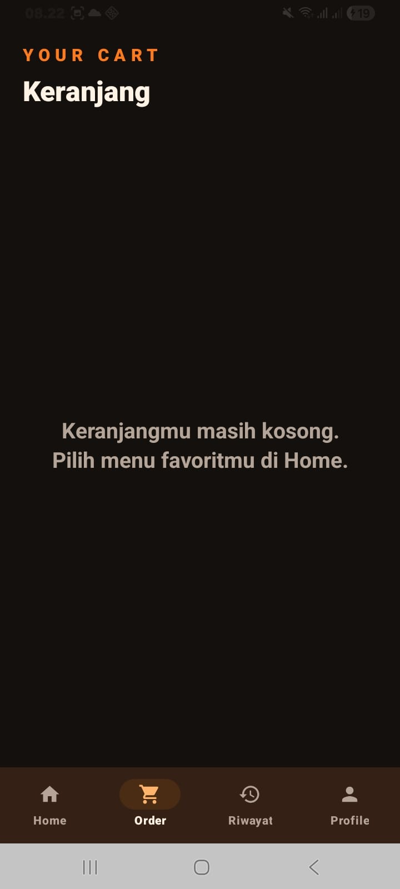 |
| **06. Keranjang (Lanjutan)** | 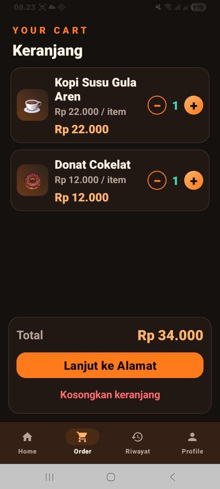 |
| **07. Alamat & Pengiriman** | 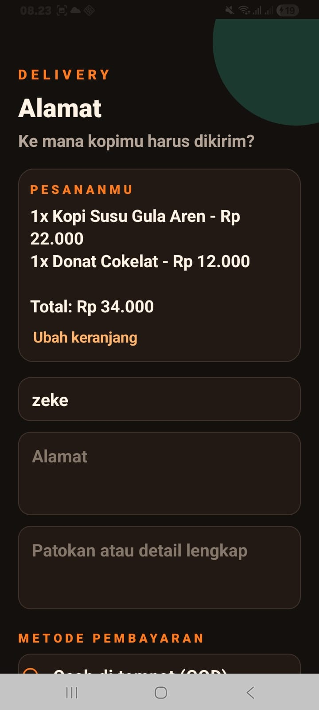 |
| **07. Alamat (Lanjutan)** | 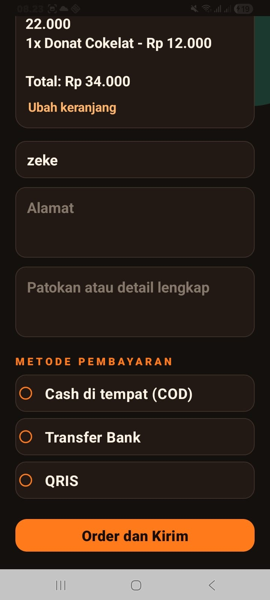 |
| **08. Pembayaran Transfer Bank** | 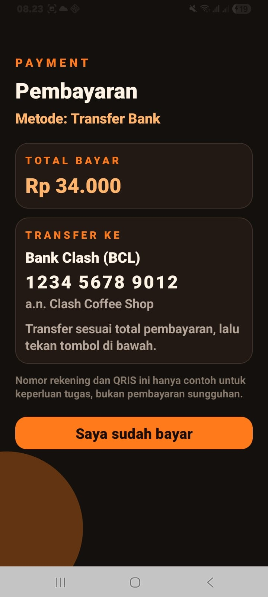 |
| **09. Pembayaran QRIS** | 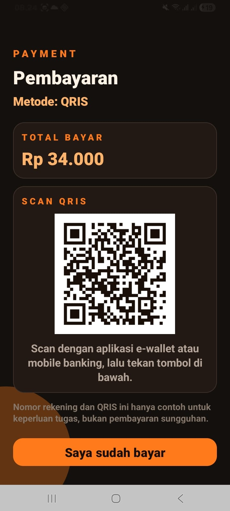 |
| **09. Pembayaran QRIS (Lanjutan)** | 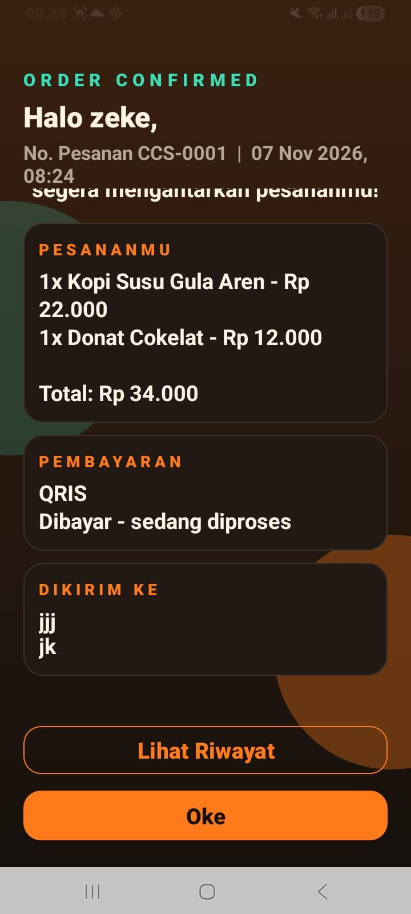 |
| **10. Konfirmasi Pesanan** | 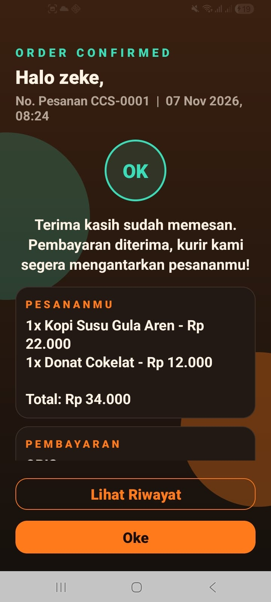 |
| **10. Konfirmasi Pesanan (Lanjutan)** | 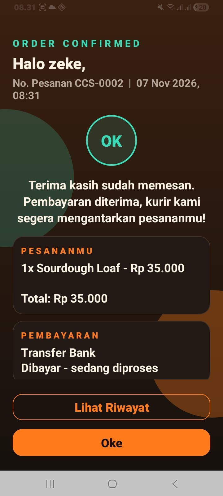 |
| **11. Riwayat Pesanan** | 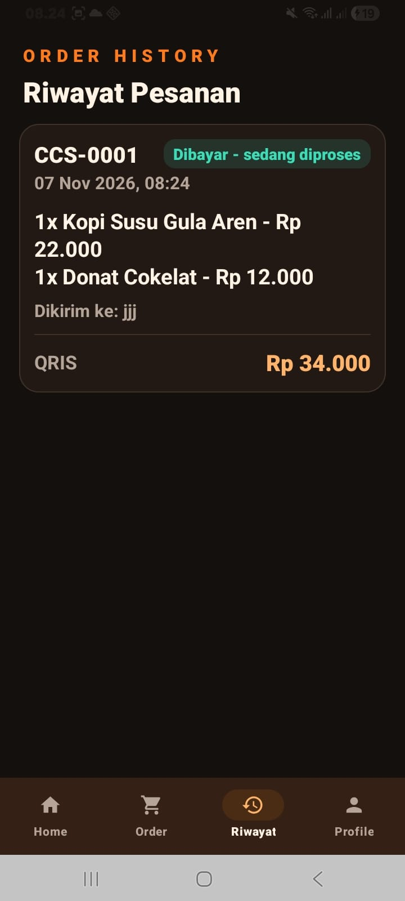 |
| **12. Profil Pengguna** | 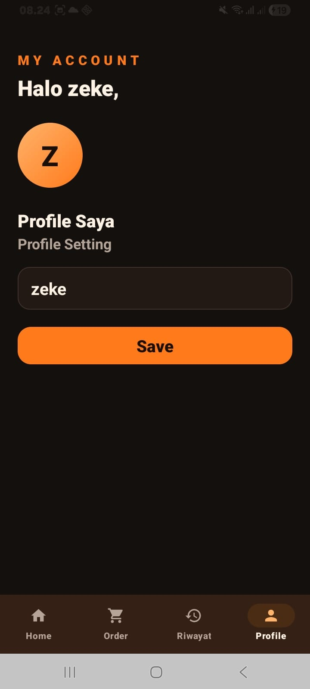 |
| **13. Pembayaran COD** | 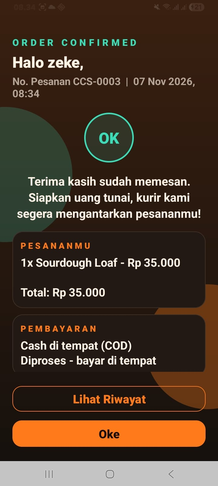 |
